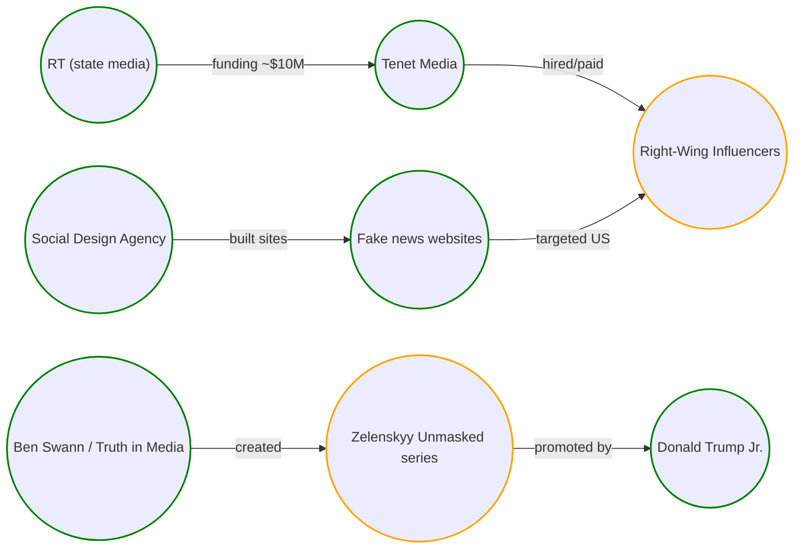
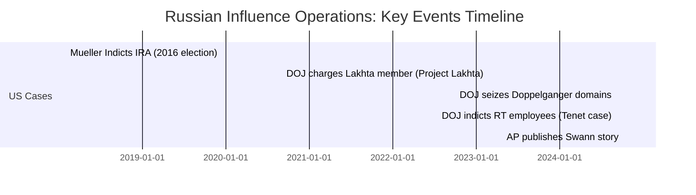

# Russian State Actors and U.S. Media: Documented Links and Propagation

*Report draft v1 — saved verbatim as provided. Formal writeup synthesizing the
documented cases. Mermaid diagrams and tables preserved.*

**Executive Summary:** Recent U.S. investigations have uncovered multiple instances
where Russian state actors covertly influenced American media outlets and
personalities. In September 2024 the DOJ charged two employees of RT (Russia
Today) – a Kremlin-funded media network – with funneling nearly $10 million through
shell companies into a Tennessee-based content firm (widely identified as *Tenet
Media*). That firm then paid well-known conservative online influencers (e.g. Tim
Pool, Benny Johnson, others) to create viral videos echoing Kremlin narratives.
Concurrently, U.S. authorities seized 32 internet domains in an "Operation
Doppelganger," showing Russian agencies (Social Design Agency, Structura, ANO
Dialog under a Putin deputy) had been creating fake U.S. news sites to spread
disinformation. Separately, an AP investigation found right-wing broadcaster Ben
Swann (Truth in Media) had long produced Kremlin-friendly content – financing it
via his company while he publicly released anti-Ukraine series (e.g. *"Zelenskyy
Unmasked"*) that were heavily promoted on social platforms by figures like Donald
Trump Jr. In sum, these documented cases illustrate how Russian state agents have
used direct funding, shell companies, fake platforms, and influencer contracts to
seed pro-Russian content into U.S. media ecosystems. The influence has reached
millions of Americans via social media and even U.S. political figures. However,
many questions remain (e.g. full network of covert websites, undisclosed
transfers) and further subpoenas (DOJ indictments, FARA filings, corporate
records) will be needed to fully map the network.

## Scope and Key Definitions
- **Media Node:** any U.S.-based media outlet, website, content platform, or
  individual content creator (influencers, pundits) that produces or disseminates
  news/political content.
- **Financial Relationship:** any flow of funds or resources (direct investment,
  advertising, contracts, stipends) between Russian state-linked entities and a
  U.S. media node. Includes covert funding (via shells) and disclosed sponsorship.
- **Amplification:** the process by which content (originating from or aligned with
  Russian state narratives) is spread or boosted by U.S. platforms or personalities.
- **Propagation:** the downstream spread of influence through networks — how ideas
  or narratives seeded in one place travel through social media, mainstream
  outlets, or to political figures and the public.

This analysis focuses on cases with **documented evidence** (criminal indictments,
official press releases, verified investigations). Where claims are unproven or
speculative, they are noted as such.

## Documented Cases of Russian-State Linkages

### Tenet Media and RT (Sept 2024)
In September 2024 the DOJ unsealed an indictment charging two RT employees
(Kostiantyn Kalashnikov and Elena Afanasyeva) with secretly funding an unnamed U.S.
media company. RT – "a state-controlled media outlet funded and directed by the
Government of Russia" – had **deployed nearly $10 million** (laundered through
foreign shell companies) to this Tennessee content firm. The company (matched by
reports to Tenet Media of Nashville) then produced almost 2,000 English-language
videos (YouTube, TikTok, Instagram, X) with "commentary on U.S. issues" designed to
"amplify domestic divisions" in line with Kremlin goals. Influencers hired
reportedly included prominent right-wing figures (Tim Pool, Benny Johnson, Dave
Rubin, Lauren Southern, etc.); DOJ refers to them anonymously, but media identify
them by follower counts and slogans. These influencers reportedly *were not
informed* of the Russian funding.

The DOJ press release emphasizes RT employees "secretly planted and financed" the
firm on U.S. soil. *Cited:* DOJ OPA press release and indictment (Sep 4, 2024); NPR
summary.

### Operation "Doppelganger": Fake U.S. News Sites (Sept 2024)
Also Sept 4, 2024: DOJ seized **32 internet domains** used in "Operation
Doppelganger." Russian PR firms – *Social Design Agency*, *Structura National
Technology*, and *ANO Dialog* (all under Kremlin deputy chief of staff Sergei
Kiriyenko) – registered domains mimicking U.S. outlets (e.g. "washingtonpost.pm",
"fox-news.network"), hosting Kremlin propaganda and funneling visitors via paid
social ads. DOJ noted the domains were "filled with Russian government propaganda"
but obfuscated as legitimate American news. DFRLab and others documented parts
since 2022. *Cited:* DOJ press release; DFLab analysis.

### Ben Swann / Truth in Media (Oct 2024)
AP (Oct 18, 2024) found **Ben Swann** had produced pro-Russian content via his
company while making "Zelenskyy Unmasked" (critical of Ukraine). Swann registered
as a foreign agent for Russia and ran two production companies: one creating
"Kremlin-friendly" content (earning millions) and another for U.S.-audience
programming. AP: Swann "has worked for Russia's state-owned media empire for
years"; one firm "earned millions of dollars for producing Kremlin-friendly
shows." "Zelenskyy Unmasked" (April 2024) coincided with U.S. debates on aid to
Ukraine and was widely promoted — Donald Trump Jr. posted it to millions of
followers. A digital marketing firm boosted the series; at least one promoter
admitted being paid to hype it. Swann said he kept his Russian work "separate," but
AP found overlapping personnel and coordination. *Cited:* AP investigation.

### IRA / "Project Lakhta" (2016–2020)
Context: In Feb 2018, a Mueller-led DOJ indictment charged 13 Russians (and 3
companies, incl. the IRA troll-farm) with conspiring to "defraud the United States"
in the 2016 election. The IRA – a St. Petersburg troll farm – was funded via
Russian shells to run a massive propaganda campaign (80 operatives, $1.25M/month by
late 2016) to "spread distrust against the candidates and the political system." No
Americans charged. In Sept 2020 DOJ/FBI charged Russian national Artem Lifshits for
his role in *Project Lakhta*, describing members creating fake social accounts that
"could pump out messaging to millions of Americans on divisive social issues"
across ideological lines. *Cited:* NPR/DOJ (IRA); AP (Project Lakhta).

### Other Cases & Reports
- **Embedded Propaganda in U.S. Media:** reports note Kremlin use of North American
  "seed sites" and content farms; do not always name specific outlets.
- **Oversight warnings (2024):** FBI/DHS warned Russian operatives pay U.S.
  influencers and unregistered agents to push narratives. Axios: DOJ found the
  Doppelganger campaign "maintained a list of more than 2,800 influencers they
  track for potential collaborations." Reuters: Russian tactics rely on "witting
  and unwitting Americans" to make foreign propaganda seem homegrown.

## Implicated U.S. Media Entities and Influencers

| Entity / Influencer | Relationship Type | Evidence / Source | Date(s) | Propagation | Confidence |
|---|---|---|---|---|---|
| **Tenet Media** (Nashville, TN) | Funding (covert) by Russian state via shell companies | DOJ indictment & press release | 2023–Sep 2024 | ~2,000 videos on YouTube/TikTok/Instagram pushing pro-Russia narratives; seeded to U.S. audiences | **High** (DOJ) |
| **Right-wing influencers** (e.g. Tim Pool, Benny Johnson, etc.) | Paid content producers (funding, content creation) | DOJ case analysis | 2023–2024 | Viral videos (immigration, elections, etc.) reflecting Kremlin talking points | **Medium** (Alleged by DOJ; not charged) |
| **Ben Swann / Truth in Media** | Content creation (financing by RT/Russia) | AP investigation | 2021–2024 | "Zelenskyy Unmasked" critical of Ukraine; amplified on social media (Trump Jr. & others) | **High** (AP) |
| **"Doppelganger" fake news sites** | Content network (propaganda outlets) | DOJ domain seizures | Since 2022 (seized Sep 2024) | Cloaked as U.S. media; spread via social ads & fake accounts | **High** (DOJ affidavit) |
| **Donald Trump Jr.** | Amplification (social-media boosting) | AP report | Apr 2024 | Posted Swann's "Zelenskyy Unmasked" to millions | **High** (AP) |

*Confidence:* **High** where official/legal sources confirm; **Medium** where links
appear in indicted schemes but targets aren't charged (or rely on investigative
reporting). *Propagation* indicates how narratives flowed from the Russian-linked
source through the U.S. media ecosystem.

## Russian Influence Network (Diagram)

Green edges documented, orange edges alleged. RT funneled money into Tenet, which
paid U.S. influencers. Swann (separate track) produced "Zelenskyy Unmasked," then
amplified by Trump Jr. via social media. Social Design Agency created spoofed news
sites (Doppelganger) spreading propaganda to U.S. audiences, indirectly reaching
some influencers.

## Influence Mechanisms and Objectives
- **Direct Covert Funding:** Russian state broadcasters covertly pay/contract
  American creators. RT used shell companies to launder ~$10M to fund U.S.
  operations; funds paid influencer contracts and created editorial direction.
- **Shell Corporations and Fake Personas:** funding hidden via foreign fronts;
  Lakhta operatives ran fake personas; Doppelganger used cybersquatted domains.
- **Content Syndication and Outsourcing:** deals with American influencers/platforms
  weave Russian narratives into English content; paid promoters reposted Swann's
  series with identical boilerplate.
- **Platform Advertising:** ad buys distribute content; Meta confirmed six-figure
  ad spend targeting U.S. audiences.
- **Influencer Networks:** Russian intelligence compiled lists of thousands of U.S.
  influencers — enlisting real personalities is more effective than fake personas.

**Objectives:** sow discord, undermine Western Ukraine policy, influence U.S.
elections. DOJ (Garland, Monaco) links these to "furthering" Russian interests by
"exploiting our free exchange of ideas" and "undermining our elections."

## Propagation into Mainstream and Politics
- **Social Media Virality:** Tenet channel reportedly >16M YouTube views by
  mid-2024; Swann's series went viral in right-wing circles.
- **Amplification by Public Figures:** Trump Jr. sharing "Zelenskyy Unmasked" is a
  prime case; other conservative personalities championed similar narratives
  (not all documented in DOJ filings).
- **Mainstream Coverage:** NYT, NPR, Axios reporting further amplified awareness.
- **Political Discourse:** anti-Ukraine tropes appeared in debates/threads; direct
  policy influence is hard to establish, but content entered the echo chamber.

## Gaps, Uncertainties, and Next Steps
- **Unnamed Individuals:** DOJ "Commentator 1/2" and unnamed contractors; full IDs
  need subpoenas/interviews. Swann's paid promoters not all publicly named.
- **Corporate Records:** forensic accounting for the $10M shells; beneficial owners
  behind SDA, Structura, etc.
- **Extent of Doppelganger Network:** 32 seized domains vs. thousands of fake assets
  found by DFRLab/Meta; a comprehensive list is needed.
- **Platform Data:** internal ad-spend/ownership/targeting data via Congress/legal
  order to map propagation.
- **FOIA and Registrations:** DOJ/FBI/Treasury FOIAs; FARA filings to confirm
  Swann's registrations and RT amounts; any Tenet principal registrations.
- **Further Indictments:** more Russian actors, or U.S. collaborators if FARA
  violations proven.

*Next Steps:* secure all court-filed affidavits/indictments (some sealed); obtain
corporate records (Tenet, Swann's companies, SDA/Structura); FOIA IRS/State visa
data; congressional oversight to compel platform transparency.

## Visualizing Timelines

## Sources
- U.S. DOJ Press Release: "Two RT Employees Indicted for Covertly Funding and
  Directing U.S. Company…" (Sep 4, 2024); Press Release: "Justice Department
  Disrupts Covert Russian Government-Sponsored…" (Sep 4, 2024).
- Associated Press (Suderman & Burke), "Right-wing influencers hyped anti-Ukraine
  videos…" (Oct 18, 2024).
- NPR (Bond/Joffe-Block), "How Russian operatives covertly hired U.S. influencers
  to create viral videos" (Sep 4, 2024).
- Reuters (Bing et al.), "Russia focusing on American social media stars to
  covertly influence voters" (Sep 9, 2024).
- Axios (Sabin), "Russian disinformation is now hiding in plain sight" (Sep 10, 2024).
- DFRLab (Sadek & Brookie), "Explainer: US catches Russia red-handed…" (Sep 17, 2024).
- Associated Press, "US sanctions Ukraine lawmaker who disclosed Biden recordings"
  (Sep 10, 2020) (Project Lakhta).
- NPR (Franklin et al.), "Grand Jury Indicts Russians Linked to Interference in
  2016 Election" (Feb 2018) (IRA indictment).
